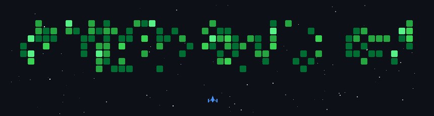

  

  
  
  <!-- Add more links here, e.g. LinkedIn:
  
  -->

---

### `> PLAYER 1`

- 🎓 Student at **42 Berlin**, the peer-to-peer, project-based coding school
- 🛠️ Building things from the ground up in **C** and **C++**: memory, processes, data structures
- 🐍 Using **Python** for scripting, automation and quick experiments
- 🌱 Always learning, one project (and one segfault) at a time

### `> INVENTORY`

  

### `> HIGH SCORES`

   

### `> LEVEL 1: CONTRIBUTIONS`

  

INSERT COIN TO CONTINUE ▮

